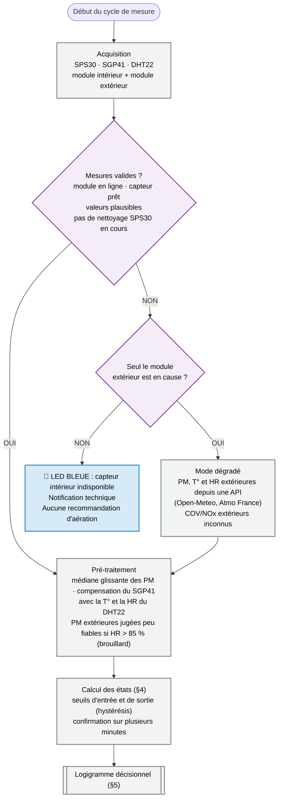
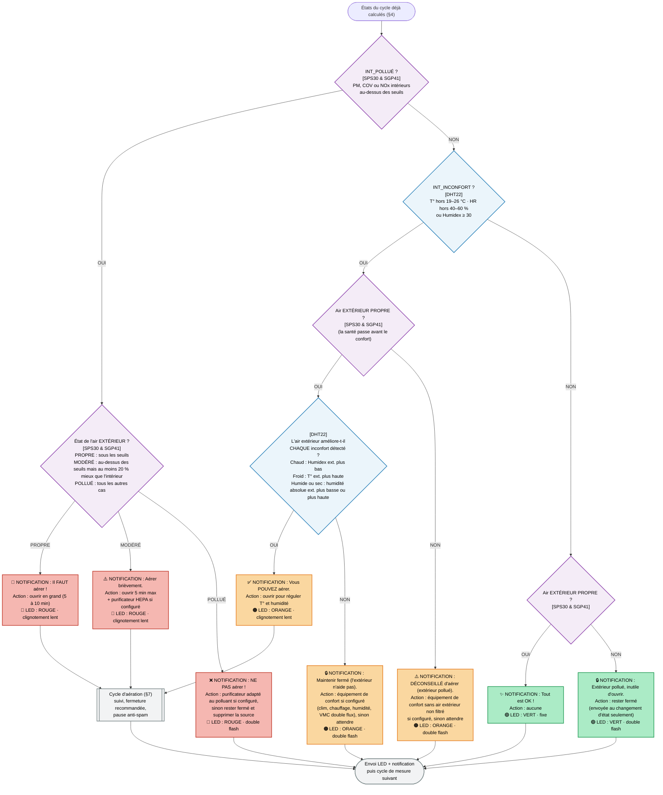
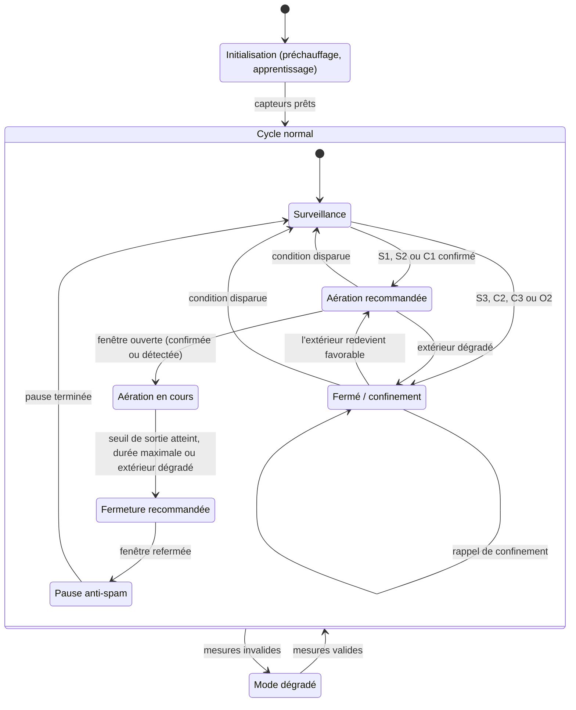

# Test-logigramme-Aircheck
Logigramme Aircheck (version 2)

Système de qualité de l'air à deux modules (intérieur et extérieur). Chaque module intègre un **SPS30** (particules fines, Sensirion), un **GY-SGP41** (COV et NOx, Sensirion) et un **DHT22 / AM2302** (température et humidité). Le but est de comparer l'air intérieur et l'air extérieur pour recommander d'aérer, ou non, en protégeant d'abord la santé.

---

## 1. Principes de conception

1. **Priorité : santé > confort > équipement.** Le confort n'est jamais recherché au détriment de la qualité de l'air.
2. **Les états sont calculés une seule fois par cycle** (§4). Le logigramme et la table de décision ne font que les combiner : plus aucun test dupliqué.
3. **Les indices COV/NOx du SGP41 ne sont jamais comparés entre l'intérieur et l'extérieur.** Ce sont des indices relatifs à l'historique de chaque capteur (100 = ambiance moyenne récente pour les COV). Seules les particules (µg/m³, valeurs absolues) servent à comparer les deux modules.
4. **Un extérieur « meilleur » n'est pas forcément « sain ».** L'air extérieur est classé en trois niveaux : PROPRE, MODÉRÉ, POLLUÉ.
5. **Les décisions sont stabilisées** : médiane glissante, hystérésis, confirmation, anti-spam (§9).
6. **Les équipements sont des paramètres de configuration** (§2), pas des questions posées à chaque cycle.
7. **Le logigramme a une fin** : cycle d'aération (§7) et mode dégradé en cas de panne (§3).
8. **La LED indique la gravité, son motif indique l'action** (§8).

---

## 2. Configuration des équipements

Ces paramètres sont définis une fois à l'installation.

| Paramètre | Valeurs | Effet sur les recommandations |
| :--- | :--- | :--- |
| `PURIFICATEUR` | `aucun` · `hepa` · `hepa_charbon` | HEPA : particules uniquement. Charbon actif : ajoute les COV (efficacité limitée sur le NOx). |
| `VMC` | `aucune` · `simple_flux` · `double_flux` | Simple flux : importe de l'air extérieur non filtré, donc traitée comme une fenêtre ouverte (utilisée seulement quand aérer est autorisé). Double flux : air neuf filtré, utilisable comme équipement de confort, sauf en cas d'événement COV/NOx extérieur. |
| `CLIM_CHAUFFAGE` | `aucun` · `clim` · `chauffage` · `les_deux` | Traitement de l'inconfort chaud ou froid sans apport d'air extérieur. |
| `HUMIDITE` | `aucun` · `deshumidificateur` · `humidificateur` · `les_deux` | Traitement de l'inconfort humide ou sec. |
| `PRISE_CONNECTEE` | `oui` · `non` | Si `oui`, les actions « activer » deviennent automatiques. Sinon elles restent des recommandations. |

---

## 3. Étape 0 : acquisition, validation et mode dégradé

- Pendant le préchauffage du SPS30 et la phase d'apprentissage du SGP41 (de quelques minutes pour les COV à plusieurs heures pour le NOx, selon la note d'application Sensirion), les mesures concernées sont ignorées.
- En mode dégradé, `EXT_GAZ_ÉVÉNEMENT` est inconnu : aucune recommandation d'aération n'est émise pour un problème de COV/NOx intérieur tant que l'extérieur n'est pas connu.

---

## 4. Étape 1 : états calculés à chaque cycle

| État | Définition | Remarque |
| :--- | :--- | :--- |
| `INT_PM_POLLUÉ` | PM2.5 int. > 15 µg/m³ ou PM10 int. > 45 µg/m³ | Médiane glissante, condition confirmée. |
| `INT_GAZ_ÉVÉNEMENT` | Indice COV int. > 150 ou indice NOx int. > 50 | Événement relatif au capteur, pas un seuil sanitaire. |
| `INT_POLLUÉ` | `INT_PM_POLLUÉ` ou `INT_GAZ_ÉVÉNEMENT` | Option : ou CO₂ > 1 000 ppm si un capteur SCD41 est ajouté. |
| `EXT_GAZ_ÉVÉNEMENT` | Indice COV ext. > 150 ou indice NOx ext. > 50 | Inconnu en mode dégradé. |
| `EXT_PROPRE` | PM2.5 ext. ≤ 15, PM10 ext. ≤ 45 et pas de `EXT_GAZ_ÉVÉNEMENT` | |
| `EXT_MODÉRÉ` | Pas de `EXT_GAZ_ÉVÉNEMENT`, PM ext. au-dessus des seuils, mais PM2.5 ext. ≤ 0,8 × PM2.5 int. et PM10 ext. ≤ 0,8 × PM10 int. | Ne peut survenir que si l'intérieur est lui-même au-dessus des seuils. |
| `EXT_POLLUÉ` | Tous les autres cas | |
| `INCONFORT_CHAUD` | T int. > 26 °C ou Humidex int. ≥ 30 | |
| `INCONFORT_FROID` | T int. < 19 °C | |
| `INCONFORT_HUMIDE` | HR int. > 60 % | |
| `INCONFORT_SEC` | HR int. < 40 % | |
| `INT_INCONFORT` | L'un des quatre inconforts ci-dessus | |
| `EXT_AMÉLIORE_CONFORT` | Vrai si **chaque** inconfort détecté est amélioré : chaud → Humidex ext. inférieur d'au moins 1 point ; froid → T ext. supérieure d'au moins 1 °C ; humide → humidité absolue ext. inférieure d'au moins 1 g/m³ ; sec → humidité absolue ext. supérieure d'au moins 1 g/m³ | Compare l'humidité absolue (pas la HR, qui dépend de la température). |

---

## 5. Étape 2 : logigramme décisionnel

---

## 6. Table de décision (tous les cas)

« INT sain » signifie `INT_POLLUÉ` faux. Chaque cas du logigramme correspond à une ligne.

| ID | Conditions | Notification | Action | LED |
| :--- | :--- | :--- | :--- | :--- |
| **S1** | `INT_POLLUÉ` + `EXT_PROPRE` | 🚨 Il FAUT aérer | Ouvrir en grand 5 à 10 min (ou VMC simple flux en surventilation) | 🔴 rouge · clignotement lent |
| **S2** | `INT_POLLUÉ` + `EXT_MODÉRÉ` | ⚠️ Aérer brièvement | Ouvrir 5 min max, purificateur HEPA en complément si configuré | 🔴 rouge · clignotement lent |
| **S3** | `INT_POLLUÉ` + `EXT_POLLUÉ` | ❌ NE PAS aérer | Purificateur adapté au polluant si configuré (HEPA : particules, charbon actif : COV), sinon rester fermé et supprimer la source (cuisson, combustion, produits d'entretien) | 🔴 rouge · double flash |
| **C1** | INT sain + `INT_INCONFORT` + `EXT_PROPRE` + `EXT_AMÉLIORE_CONFORT` | ✅ Vous POUVEZ aérer | Ouvrir pour réguler la température et l'humidité | 🟠 orange · clignotement lent |
| **C2** | INT sain + `INT_INCONFORT` + `EXT_PROPRE` + extérieur sans bénéfice | 🔒 Maintenir fermé | Équipement de confort configuré, sinon attendre. Jamais de VMC simple flux. | 🟠 orange · double flash |
| **C3** | INT sain + `INT_INCONFORT` + extérieur non propre | ⚠️ DÉCONSEILLÉ d'aérer | Équipement de confort sans apport d'air non filtré, sinon attendre | 🟠 orange · double flash |
| **O1** | INT sain + pas d'inconfort + `EXT_PROPRE` | ✨ Tout est OK | Aucune | 🟢 vert · fixe |
| **O2** | INT sain + pas d'inconfort + extérieur non propre | 🔒 Extérieur pollué, inutile d'ouvrir | Rester fermé (notification seulement au changement d'état) | 🟢 vert · double flash |
| **D** | Capteur intérieur indisponible (§3) | 🔧 Capteur indisponible | Aucune recommandation | 🔵 bleu · fixe |

---

## 7. Cycle d'aération

Le logigramme ne s'arrête plus à « Ouvrir les fenêtres » : une machine à états suit l'aération jusqu'à la fermeture, puis impose une pause pour éviter les notifications en rafale.

- **Détection de l'ouverture** : confirmation dans l'application, ou rapprochement des valeurs intérieures (PM, T°, humidité absolue) vers les valeurs extérieures.
- **Fermeture recommandée** (message « Vous pouvez refermer ») quand l'une de ces conditions est remplie : l'intérieur repasse sous le seuil de sortie, la durée maximale est atteinte (10 min), l'extérieur se dégrade, ou l'objectif de confort est atteint.
- **Pause anti-spam** : 15 min après la fermeture, aucune nouvelle notification du même type.
- **Rappel de confinement** : toutes les 60 min en état « fermé », si l'intérieur reste pollué, la notification rappelle de supprimer la source et d'envisager une aération brève dès que l'extérieur s'améliore.

---

## 8. LED : gravité et action

La **couleur** indique la qualité de l'air intérieur. Le **motif** indique l'action recommandée.

| Couleur | Signification |
| :--- | :--- |
| 🟢 Vert | Air intérieur sain et confort correct |
| 🟠 Orange | Air sain, confort dégradé (température ou humidité) |
| 🔴 Rouge | Pollution intérieure au-dessus des seuils |
| 🔵 Bleu | Capteur indisponible ou initialisation |

| Motif | Signification |
| :--- | :--- |
| Fixe | Rien à faire |
| Clignotement lent | Aérer (ouvrir les fenêtres) |
| Double flash | Ne pas aérer, rester fermé |

- Le motif porte l'information même pour les personnes daltoniennes, pour qui rouge, orange et vert se confondent facilement. La notification ajoute un texte et une icône.
- **Mode nuit** (par défaut 22 h à 7 h, réglable) : LED atténuée et notifications muettes, sauf alerte santé (rouge).
- Les actions sur les équipements (purificateur, VMC, clim) passent par la notification, ou sont automatiques avec `PRISE_CONNECTEE = oui`.

---

## 9. Seuils d'alerte, hystérésis et références

Le système s'appuie sur des normes sanitaires mondiales et les spécifications des constructeurs pour déclencher les alertes de qualité de l'air et de confort. Chaque alerte a un **seuil d'entrée** et un **seuil de sortie** plus bas pour éviter les basculements répétés.

| Paramètre | Capteur | Seuil d'alerte intérieur (entrée) | Seuil de sortie | Source & Référence |
| :--- | :--- | :--- | :--- | :--- |
| **PM2.5** | SPS30 | > 15 µg/m³ | < 12 µg/m³ | [Directives OMS 2021](https://www.who.int/publications/i/item/9789240034228) - Résumé d'orientation, Tableau 1. |
| **PM10** | SPS30 | > 45 µg/m³ | < 36 µg/m³ | [Directives OMS 2021](https://www.who.int/publications/i/item/9789240034228) - Résumé d'orientation, Tableau 1. |
| **Indice COV** | GY-SGP41 | > 150 (sur 500) | < 120 | [Datasheet Sensirion SGP41](https://sensirion.com/media/documents/5FE867AE/61E96FE8/Sensirion_Gas_Sensors_SGP41_Datasheet.pdf) - Section "VOC/NOx Algorithm" (100 = Moyenne, >150 = Détérioration). Indice relatif au capteur. |
| **Indice NOx** | GY-SGP41 | > 50 (sur 500) | < 40 | [Datasheet Sensirion SGP41](https://sensirion.com/media/documents/5FE867AE/61E96FE8/Sensirion_Gas_Sensors_SGP41_Datasheet.pdf) - Section "VOC/NOx Algorithm" (1 = Fond normal). Indice relatif au capteur. |
| **Humidité (HR)** | DHT22 | < 40 % ou > 60 % | > 42 % et < 58 % | [Guide ADEME "Un air sain chez soi"](https://www.grandnancy.eu/fileadmin/fichiers/VIVRE_ET_HABITER/Environnement/Qualite_air/guide-pratique-un-air-sain-chez-soi.pdf) - Page 16 "Évacuez l'humidité excessive". |
| **Température (T)** | DHT22 | < 19 °C ou > 26 °C | > 19,5 °C et < 25,5 °C | [Guide ADEME "Un air sain chez soi"](https://www.grandnancy.eu/fileadmin/fichiers/VIVRE_ET_HABITER/Environnement/Qualite_air/guide-pratique-un-air-sain-chez-soi.pdf) - Limites de confort été/hiver. |
| **Humidex** | DHT22 | ≥ 30 | < 29 | [Gouvernement du Canada, Humidex](https://www.canada.ca/fr/services/environnement/meteo/conditionsdangereuses/humidex.html) - Échelle de degré d'inconfort. |

Les seuils OMS pour les PM sont des **moyennes sur 24 h**. Pour réagir à des événements courts (cuisson, passage d'un véhicule), le système applique ces valeurs à une médiane glissante de quelques minutes, ce qui est volontairement plus strict. Une **moyenne glissante sur 24 h** est calculée en parallèle pour le suivi sanitaire : c'est elle qui se compare directement à la ligne directrice OMS.

### Paramètres de stabilité et marges (réglables)

| Paramètre | Valeur par défaut | Rôle |
| :--- | :--- | :--- |
| Lissage des PM | Médiane glissante de 10 min (5 à 15 min) | Ignore les pics très courts. |
| Confirmation | Condition maintenue 3 min | Évite les fausses alertes. |
| Marge intérieur/extérieur (PM) | Extérieur ≤ 80 % de l'intérieur | Absorbe l'écart entre les deux SPS30 (précision de l'ordre de ±10 µg/m³ à bas niveau). |
| Marges de confort | 1 point d'Humidex, 1 °C, 1 g/m³ d'humidité absolue | Évite de recommander une aération pour un gain négligeable. |
| Durée maximale d'aération | 10 min | Limite les pertes de chaleur et l'entrée de polluants. |
| Pause anti-spam | 15 min | Limite les notifications. |
| Rappel de confinement | 60 min | Évite le confinement prolongé sans action. |

---

## 10. Méthodes de calcul et confort thermique

Le capteur **DHT22** remonte deux valeurs brutes : la Température ($T$ en °C) et l'Humidité Relative ($HR$ en %).
Pour évaluer le confort humain réel (qui dépend de l'effet combiné de la chaleur et de l'humidité), le système calcule la **température de rosée**, l'**humidité absolue**, puis l'**Humidex** (température ressentie). Ces trois grandeurs sont calculées pour **l'intérieur et pour l'extérieur** afin de les comparer.

### Explication simple
Quand l'air est très humide, la sueur s'évapore moins bien. Le corps humain n'arrive plus à se refroidir naturellement. C'est pourquoi 25°C avec 80% d'humidité est ressenti comme beaucoup plus étouffant que 25°C avec 40% d'humidité. Les calculs ci-dessous permettent au logiciel de "comprendre" cet étouffement.

L'**humidité relative** dépend de la température : de l'air extérieur à 10 °C et 80 % d'HR contient en réalité moins d'eau qu'une pièce à 22 °C et 50 % d'HR. Pour savoir si l'air extérieur assèche ou humidifie une pièce, on compare donc l'**humidité absolue** (ou le point de rosée), jamais la HR.

### 1. Calcul de la Pression de vapeur et du Point de Rosée
On utilise la formule météorologique de Magnus-Tetens pour déterminer le point de condensation. 

**Étape A : Calcul de la variable intermédiaire $\alpha$**

$\alpha = \frac{17,27 \times T}{237,7 + T} + \ln\left(\frac{HR}{100}\right)$

**Étape B : Calcul de la Température de rosée ($T_d$ en °C)**

$T_d = \frac{237,7 \times \alpha}{17,27 - \alpha}$

### 2. Calcul de l'Humidex (Température ressentie)
À partir de la température et de l'humidité, on détermine la pression de vapeur d'eau ($e$ en hPa), puis on calcule l'indice Humidex.

**Calcul de la pression de vapeur d'eau ($e$) :**

$e = 6,112 \times 10^{\left( \frac{7,5 \times T_d}{237,7 + T_d} \right)}$

**Formule finale de l'Humidex ($H$) :**

$H = T + 0,5555 \times (e - 10)$

**Interprétation du résultat Humidex par le logiciel** (échelle du [Gouvernement du Canada](https://www.canada.ca/fr/services/environnement/meteo/conditionsdangereuses/humidex.html)) :
*   **H < 30 :** Aucun inconfort notable (zone verte).
*   **30 ≤ H < 40 :** Inconfort léger à modéré (`INCONFORT_CHAUD`). Nécessite de vérifier si l'air extérieur est plus frais pour aérer.
*   **40 ≤ H ≤ 45 :** Inconfort fort, éviter les efforts.
*   **H > 45 :** Danger.

### 3. Calcul de l'humidité absolue
À partir de la pression de vapeur $e$ (en hPa) et de la température $T$ (en °C), on obtient la masse de vapeur d'eau par m³ d'air :

$HA = \frac{216,7 \times e}{273,15 + T}$ (en g/m³)

Règles d'usage : si l'intérieur est trop **humide**, l'extérieur aide quand $HA_{ext} < HA_{int}$. S'il est trop **sec**, l'extérieur aide quand $HA_{ext} > HA_{int}$ (avec la marge de 1 g/m³ du §9). Cela évite par exemple de faire entrer de l'air chaud et humide dans une pièce fraîche (condensation, moisissures).

---

## 11. Limites connues et pistes d'amélioration

- **DHT22** : précision typique de ±2 % HR et ±0,5 °C (jusqu'à ±5 % HR), mesure lente, sensible à l'échauffement du boîtier. Un **SHT40 / SHT45** (Sensirion, I²C) est un bon remplaçant.
- **SPS30** : précision de l'ordre de ±10 µg/m³ à bas niveau, proche du seuil de 15 µg/m³. Nettoyage automatique périodique du ventilateur (mesures à ignorer). Les PM sont surestimées en cas de brouillard ou d'humidité très élevée.
- **SGP41** : indices relatifs, non comparables entre les deux modules. Il faut lui fournir la T° et la HR du DHT22 pour la compensation.
- **Calibrage inter-modules** : placer les deux modules côte à côte quelques jours, mesurer l'écart et le corriger avant de s'appuyer sur la marge de 20 %.
- **Placement** : éloigner le module intérieur des sources locales (cuisine, bougies) et de la chaleur, abriter le module extérieur du soleil direct et de la pluie.
- **Capteur de CO₂** (SCD41, même famille Sensirion, I²C) : meilleur indicateur du besoin d'aération. Il s'intégrerait directement dans `INT_POLLUÉ`.
- **Tendance et prévision** : proposer « aérer cette nuit à partir de 22 h » en cas de chaleur, ou un créneau d'aération après un pic de pollution. Une pente montante des PM intérieures permet aussi d'alerter avant le seuil.
- **Historique des mesures** pour suivre l'évolution sur plusieurs jours.

---

## 12. Changements par rapport à la version 1

- États calculés une fois par cycle, puis combinés dans le logigramme et la table de décision.
- Air extérieur classé en trois niveaux (PROPRE, MODÉRÉ, POLLUÉ) au lieu de « meilleur / pire ».
- Indices COV/NOx comparés à la normale de chaque module, plus jamais entre eux.
- Confort aligné sur le tableau des seuils (froid, chaud, humide, sec) et sur l'Humidex ; comparaison intérieur/extérieur via l'humidité absolue.
- Équipements déplacés dans la configuration ; plus de VMC simple flux quand l'extérieur n'est pas propre.
- LED cohérente : couleur = gravité, motif = action ; couleurs des cases identiques à celles des LED.
- Ajout de la validation des mesures, du mode dégradé, de l'hystérésis, du cycle d'aération et de l'échelle Humidex complète (plus de trous entre les tranches).
